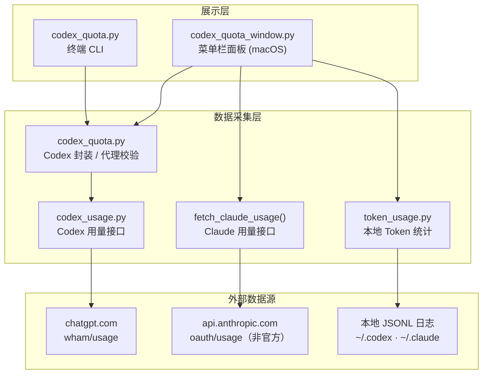

# codex-quota

在终端或 macOS 菜单栏查询 Codex、Claude 登录账户的剩余额度与本地 Token 用量。

## 项目架构

项目按「数据采集 → 展示 → 打包」三层组织,核心逻辑不依赖任何 GUI 框架,
菜单栏面板只是数据层之上的一个 macOS 原生前端。

### 分层与模块职责

| 模块 | 层 | 职责 |
|------|-----|------|
| [codex_usage.py](codex_usage.py) | 数据采集 | Codex 用量底层实现:读取本地 OAuth(`auth.json`/钥匙串)、按需刷新 Token 并写回、请求 `chatgpt.com/backend-api/wham/usage`,并把响应归一化为统一的窗口结构 |
| [codex_quota.py](codex_quota.py) | 数据采集 + 终端 UI | Codex 的对外封装与命令行入口:代理校验(`normalize_proxy_url`)、`fetch_quota`、快照解析(`_snapshots`),以及带颜色进度条的终端渲染 |
| [token_usage.py](token_usage.py) | 数据采集 | 纯本地 Token 计量:扫描 Codex/Claude 的 JSONL 会话日志,解析用量事件、去重(增量/子代理回放/消息 ID),按今天/昨天/最近 30 天汇总并生成每日序列 |
| [codex_quota_window.py](codex_quota_window.py) | 展示(macOS) | 菜单栏面板:`NSStatusItem` + `NSPopover` 原生实现;内含 Claude 用量查询(`fetch_claude_usage`)、托盘图标绘制、popover 布局与本地 Token 柱状图 |

三个数据采集模块(`codex_usage`、`codex_quota`、`token_usage`)是纯 Python、跨平台的;
只有 `codex_quota_window` 依赖 PyObjC/AppKit,仅限 macOS。因此终端版可在 Windows 上打包运行。

### 依赖关系与数据流



菜单栏面板每 20 分钟(可调)触发一次刷新:在后台线程并行拉取 Codex 配额、Claude
配额与本地 Token 用量,再回到主线程渲染 popover 并更新托盘图标,避免网络请求阻塞
UI。凭据只用于当次只读请求,统计与解析全部在本机完成。

### 目录结构

```
codex-quota/
├── codex_usage.py            # Codex 用量接口 + OAuth 读取/刷新
├── codex_quota.py            # Codex 封装 + 终端 CLI(codex-quota)
├── token_usage.py            # 本地 Codex/Claude Token 统计
├── codex_quota_window.py     # macOS 菜单栏面板(codex-quota-window)
├── assets/
│   ├── codex.icns            # macOS 应用图标
│   └── provider-icons/       # 托盘 Codex/Claude 模板图标(SVG)
├── tests/                    # 各数据模块的单元测试
├── CodexQuota.spec           # PyInstaller 配置(macOS .app)
├── CodexQuotaWindows.spec    # PyInstaller 配置(Windows .exe)
├── build_macos.sh            # macOS 一键打包脚本
├── build_windows.bat         # Windows 一键打包脚本
├── pyproject.toml            # 包元数据与命令入口
└── requirements.txt          # 打包依赖
```

## 一键打包

打包脚本会创建独立的构建虚拟环境，自动安装 `requirements.txt` 中的依赖，
然后清理并重新生成安装包。PyInstaller 不支持跨平台打包，请在对应操作系统上运行。

### macOS

在项目目录运行：

```bash
chmod +x build_macos.sh
./build_macos.sh
```

生成文件：`dist/CodexQuota.app`

脚本使用 `CodexQuota.spec` 打包 macOS 菜单栏应用。应用只在顶部菜单栏常驻，
不会同时占用 Dock。构建环境位于 `.build-venv-macos`。

### Windows

在 Windows 上直接双击 `build_windows.bat`，也可以在 `cmd` 中运行：

```bat
build_windows.bat
```

生成文件：`dist\codex-quota.exe`

脚本使用 `CodexQuotaWindows.spec` 打包终端版程序，构建环境位于
`.build-venv-windows`。当前图形面板基于 macOS AppKit，因此 Windows 产物不包含
菜单栏图形界面，可在 PowerShell 或 `cmd` 中使用：

```powershell
.\dist\codex-quota.exe --help
.\dist\codex-quota.exe --json
```

如需自定义 macOS 图标，请将图标放在 `assets/codex.icns`；没有图标也可以构建，
此时使用默认图标。

在终端或 macOS 菜单栏查询当前 Codex、Claude 登录账户的剩余额度。Codex 部分采用
与 OpenUsage 相同的方式：读取 Codex 已保存的 OAuth 登录，直接请求
`https://chatgpt.com/backend-api/wham/usage`，不需要启动 Codex App 或
`codex app-server`。

## 要求

- Python 3.9+
- 曾通过 Codex CLI 登录 ChatGPT 账户（打包后的应用运行时不依赖 `codex` 可执行文件）
- 菜单栏面板（`codex_quota_window.py`）仅支持 macOS，依赖 PyObjC
- 可选：已通过 `claude` 登录 Claude Code，用于显示 Claude Session/Weekly 剩余额度；
  未登录时面板里会显示对应的查询失败提示，不影响 Codex 部分正常工作

## 直接运行

```bash
python3 codex_quota.py
```

## 菜单栏面板

基于 `NSStatusItem` + `NSPopover` 原生实现（PyObjC/AppKit），不是第三方 GUI 框架
模拟出来的窗口，定位、圆角、阴影都由 macOS 系统直接处理（面板开合做成了瞬时
无动画，规避了脚本化启动场景下 `NSPopover` 关闭动画偶发卡死的问题，交互上更可靠）。

```bash
python3 -m pip install pyobjc-framework-Cocoa
python3 codex_quota_window.py
```

程序启动后常驻 macOS 顶部菜单栏，以“提供商图标 + 短周期剩余百分比”的形式并排
显示 Codex 与 Claude，例如 `Codex 图标 72%  Claude 图标 43%`；加载时显示 `—`，
查询失败时显示 `!`，并自动适配浅色/深色菜单栏。单击菜单栏图标即可在图标正下方
展开圆角深色详情面板（原生
popover，自带箭头指向图标），点击面板外部、按 Esc 或再次点击图标会自动收起；
右键图标可退出应用。Codex 与 Claude 的配额默认每 15 分钟一起自动刷新（这两个
窗口本身是 5 小时 / 7 天粒度，更高的频率没有意义，还会增加撞上接口限流的概率），
面板内也可手动刷新，也可以调整刷新间隔：

面板底部还会显示 Claude Session（5 小时窗口）、Weekly（7 天窗口），以及账户实际
返回的 Sonnet、Fable 和 Extra Usage，样式和 Codex 部分一致。Codex 的窗口会按返回的
实际周期识别，因此只有 Weekly 时也不会被误标成短周期。Anthropic 没有对应的公开
限额接口，
这里用的是 Claude Code 自己也在用的**非官方**接口 `GET api.anthropic.com/api/oauth/usage`：
按 Claude Code 的规则优先读取 macOS 钥匙串（包括 `CLAUDE_CONFIG_DIR` 对应的条目），
再退回读取配置目录中的 `.credentials.json`；某个来源失效时会继续尝试下一个来源。
OAuth access token 只用于向 Anthropic 发起这一次只读请求，不落盘、不外传、不做 token
刷新——所有来源都失效后，面板会提示重新运行 `claude` 登录，而不是静默续期。
这个接口没有文档、可能随时变化，请知悉。

每个提供商下方还会显示 **本地 Token 用量**，分别统计今天、昨天和最近 30 天的
调用次数与 Token 数，并用
一张可左右滑动的小柱状图展示最近 30 个自然日的每日用量（默认显示最新 7 天，
鼠标悬停到某根柱子时只显示当天的精确 Token 数）：

- Codex 扫描 `$CODEX_HOME`（默认 `~/.codex`）下的 `sessions/` 和
  `archived_sessions/` JSONL 日志；按累计值计算增量，并过滤重复快照、子代理回放和
  重复日志。
- Claude 扫描 `$CLAUDE_CONFIG_DIR/projects`（默认 `~/.claude/projects`）以及 Claude
  Cowork 的本地会话日志；按消息 ID 去重，避免 sidechain 回放重复计数。
- Token 统计全部在本机完成，只读取日志，不修改日志，也不会上传日志内容。已扫描且
  未变化的文件会在内存中复用解析结果，定时刷新不会反复解析全部历史记录。

```bash
python3 codex_quota_window.py --refresh 60
```

### HTTP 代理

点击面板右上角的 **⚙︎**，可以填写 HTTP(S) 代理，例如
`http://127.0.0.1:7890`。保存后会立即刷新，并同时用于 Codex 和 Claude 的用量
接口；点击 **清除** 后恢复系统默认网络设置。代理地址保存在当前用户的 macOS
应用偏好设置中，不会写入项目文件或日志。

终端命令也可以临时指定代理：

```bash
codex-quota --proxy http://127.0.0.1:7890
```

## 安装为命令

```bash
python3 -m pip install -e .
codex-quota
codex-quota-window
```

## 常用选项

```bash
# 输出原始 JSON
codex-quota --json

# 每 30 秒刷新
codex-quota --watch 30

# 禁用颜色
codex-quota --no-color

# 使用 HTTP 代理
codex-quota --proxy http://127.0.0.1:7890
```

运行 `codex-quota --help` 查看全部选项。

## 说明

- “剩余百分比”按 Codex 返回的 `usedPercent` 计算。
- 重置时间会转换为本机时区，并显示距离重置的大致时长。
- Codex 接口返回限额重置额度时，面板和终端会显示当前可用重置次数（包括 0 次）。
- 本地用量中的“调用”按去重后的 Token 用量事件计数，代表有用量记录的模型响应次数。
- Codex 用量接口属于 ChatGPT 后端接口，应用会在 OAuth Token 即将过期或接口返回
  401/403 时刷新 Token，并把轮换后的 Token 写回原来的 `auth.json` 或钥匙串。
- Claude 用量查询的接口/凭据读取方式参考了开源项目
  [robinebers/openusage](https://github.com/robinebers/openusage)（`docs/providers/claude.md`）
  的公开实现；同样属于非官方接口，Anthropic 调整后可能需要同步更新。
